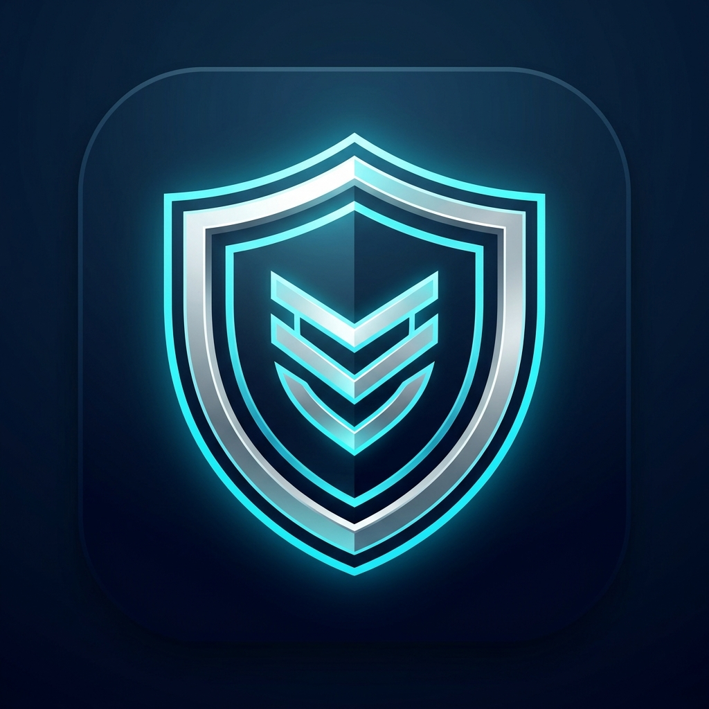

<p align="center">
  
</p>

<h1 align="center">GUARDIAN</h1>

<p align="center">
  <b>Personal Laptop Security, Real-Time Telemetry Defense & Grounded Local AI</b><br />
  Cross-Platform Defense for Windows 10/11 and macOS (Apple Silicon & Intel)
</p>

<p align="center">
  
  
  
  
  
  
</p>

---

## Table of Contents

1. [Overview](#1-overview)
2. [Technology Stack](#2-technology-stack)
3. [Step-by-Step Installation Guide for Windows](#3-step-by-step-installation-guide-for-windows)
4. [Step-by-Step Installation Guide for macOS (MacBook)](#4-step-by-step-installation-guide-for-macos-macbook)
5. [Native Standalone Application Window Mode](#5-native-standalone-application-window-mode)
6. [Step-by-Step Setup Guide for Guardian AI](#6-step-by-step-setup-guide-for-guardian-ai)
7. [Manual Developer Setup and Test Verification](#7-manual-developer-setup-and-test-verification)
8. [Core Security and Telemetry Capabilities](#8-core-security-and-telemetry-capabilities)
9. [Step-by-Step Uninstallation Guide](#9-step-by-step-uninstallation-guide)
10. [Privacy Guarantee and Safety Boundaries](#10-privacy-guarantee-and-safety-boundaries)
11. [Summary of Essential Commands](#11-summary-of-essential-commands)
12. [License](#12-license)

---

## 1. Overview

Guardian is a lightweight, local-first laptop security background worker, telemetry cockpit, and AI analyst. It protects personal laptops by continuously monitoring active network sockets, listening ports, hardware sensors (webcam/microphone), remote administration tools, and host security safeguards.

All telemetry remains strictly local to your machine. Guardian binds exclusively to `127.0.0.1` and never uploads telemetry, credentials, or file bytes to external cloud servers.

### Key Highlights

- **Native Desktop App Experience**: Launches in dedicated standalone window mode without web browser tabs or address bars.
- **Cross-Platform Support**: Native hooks for both Windows (PowerShell persistent worker, Defender, Task Scheduler) and macOS (`lsof`, XProtect, Gatekeeper, SIP, `launchd`).
- **Guardian AI (Dual-Engine)**: Local Ollama model integration coupled with an instant, deterministic Local Expert RAG engine grounded in your real-time telemetry.
- **Remote Access and Spying Detection**: Real-time identification of 30+ remote administration tools, RDP sessions, and active webcam/microphone hardware access.
- **Incident Containment**: Audited firewall rule generation, unauthorized remote session termination, emergency network isolation with auto-restore timers, and signed evidence packs.
- **Automated Test Suite**: 48 unit and integration tests verifying database integrity, heuristic detection rules, containment actions, and REST APIs.

---

## 2. Technology Stack

- **Node.js**: Backend runtime & daemon
- **Express.js**: REST API & static file serving
- **Socket.IO**: Real-time WebSocket telemetry streaming
- **SQLite3**: Local database with WAL mode
- **HTML5**: Cockpit layout & modal UI
- **Vanilla CSS3**: Custom design system, dark/light themes, glassmorphism
- **Vanilla JavaScript ES6+**: Frontend client logic & real-time DOM updates
- **Chromium App Mode**: Standalone desktop window via Edge/Chrome/Brave `--app` flag
- **Web App Manifest**: `manifest.json` for standalone PWA configuration
- **Ollama**: Local LLM engine for AI queries
- **Local RAG Engine**: Offline knowledge retrieval grounded in live telemetry
- **PowerShell**: Windows persistent host, Event Log, Defender, and Firewall integration
- **macOS Commands**: `lsof`, `ps`, `pfctl`, `spctl`, `csrutil`, `launchd`
- **Crypto & Buffer APIs**: Node.js native SHA-256 evidence hashing and PE entropy analysis

---

## 3. Step-by-Step Installation Guide for Windows

Follow these steps to install and run Guardian on Windows 10 or Windows 11 (64-bit).

### Step 1: Install Node.js LTS
Guardian requires Node.js version 20 or higher.
1. Download the installer from the official website: `https://nodejs.org/`
2. Run the downloaded installer and complete the setup wizard.
3. Open PowerShell and verify the installation:
   ```powershell
   node -v
   npm -v
   ```

### Step 2: Clone or Download the Repository
Clone the repository using Git or download and extract the ZIP archive to your desired directory:
```powershell
git clone https://github.com/WilWilbert123/LaptopGuard.git C:\Guardian
cd C:\Guardian
```

### Step 3: Run the 1-Click Windows Installer
1. Navigate to the `installer` folder in File Explorer or PowerShell:
   ```powershell
   cd installer
   ```
2. Right-click `install.bat` and select **Run as administrator** (or execute from an elevated PowerShell):
   ```powershell
   .\install.bat
   ```
3. What the installer automatically performs:
   - Verifies Node.js and npm availability.
   - Installs production dependencies (`npm install`).
   - Copies `.env.example` to `.env` if not present.
   - Registers a Windows Scheduled Task (`GuardianSecurity_BackgroundWorker`) configured to launch silently in the background on user logon.
   - Generates a desktop shortcut titled **Guardian** linked to the custom brand icon.

### Step 4: Launch Guardian
You can launch the Guardian cockpit using any of the following methods:
- Double-click the **Guardian** shortcut on your Windows Desktop.
- Run `installer\Guardian.bat`.
- Open your browser and navigate to:
  ```
  http://127.0.0.1:3000
  ```

---

## 4. Step-by-Step Installation Guide for macOS (MacBook)

Follow these steps to install and run Guardian on macOS (Apple Silicon M1/M2/M3/M4 or Intel).

### Step 1: Install Node.js LTS
If Node.js is not yet installed:
1. Download the macOS installer (.pkg) from: `https://nodejs.org/`
   Alternatively, install via Homebrew:
   ```bash
   brew install node
   ```
2. Verify in Terminal:
   ```bash
   node -v
   npm -v
   ```

### Step 2: Clone or Extract the Repository
```bash
git clone https://github.com/WilWilbert123/LaptopGuard.git ~/Guardian
cd ~/Guardian
```

### Step 3: Run the 1-Click macOS Installer
You can install using either the Finder GUI or the Terminal:

- **Method A (Finder GUI)**:
  1. Open the `installer` folder in Finder.
  2. Double-click `Install-Guardian.command`.
  
- **Method B (Terminal)**:
  ```bash
  cd installer
  bash install-mac.sh
  ```

What the macOS installer automatically performs:
- Installs all dependencies (`npm install`).
- Configures environment variables (`.env`).
- Builds a native macOS application bundle (`Guardian.app`) and places it in your `/Applications` directory.
- Registers a `launchd` background daemon (`~/Library/LaunchAgents/com.guardian.laptopguard.plist`) so Guardian starts automatically whenever you log into your MacBook.
- Starts the background service immediately.

### Step 4: Launch Guardian on macOS
- Open **Finder** > **Applications** and click **Guardian.app**.
- Or trigger Spotlight (`Command + Space`), type `Guardian`, and press `Enter`.
- Or double-click `installer/Launch-Guardian-App.command`.

---

## 5. Native Standalone Application Window Mode

Guardian is designed to run as an independent desktop application rather than a regular browser tab.

```
+-----------------------------------------------------------------------+
|  [Icon] Guardian - Security Operations Cockpit               [ - ][ X ]|
+-----------------------------------------------------------------------+
|  Active Connections: 246    Listening Ports: 112    Posture: Grade A  |
|  Defender/XProtect: Protected                       Findings: 0 High  |
+-----------------------------------------------------------------------+
```

### How Application Mode Operates
1. The launcher scripts (`Guardian-Launcher.vbs` on Windows, `Guardian.app` on macOS) scan for installed Chromium runtimes (Microsoft Edge, Google Chrome, Brave, Chromium).
2. The runtime is invoked with the standalone application flag:
   ```bash
   --app=http://127.0.0.1:3000 --app-id=GuardianSecurity --window-size=1360,860
   ```
3. This creates a dedicated application window with:
   - Zero address bar, bookmarks bar, or navigation buttons.
   - Dedicated taskbar/dock grouping with the official Guardian shield icon.
   - Persistent window dimensions and isolated process boundaries.
4. If no Chromium browser is found, Guardian gracefully opens in your default system web browser.

---

## 6. Step-by-Step Setup Guide for Guardian AI

Guardian features an integrated, floating AI Security Assistant that has real-time context of your active connections, listening ports, remote administration tools, hardware sensors, and antivirus posture.

### Architecture: Dual-Engine Design
- **Engine 1 (Local Ollama LLM)**: Connects to a locally running Ollama instance for conversational, generative analysis.
- **Engine 2 (Built-in Local RAG Engine)**: Operates 100% offline with zero dependencies. Computes exact metrics from live SQLite telemetry and provides instant (0.01-second) responses.

### Step 1: Install Ollama (Optional for Local LLM Engine)
1. Download Ollama from: `https://ollama.com/download`
2. Complete the installation for Windows or macOS.

### Step 2: Download the Recommended Lightweight Model
Open PowerShell or Terminal and pull the compact, high-efficiency model:
```bash
ollama run qwen2.5:1.5b
```
*(You can also use `llama3.2:1b`, `llama3.2:3b`, `mistral`, or `phi3`.)*

### Step 3: Configure Environment Variables
Verify your `.env` file settings:
```ini
OLLAMA_HOST=http://127.0.0.1:11434
OLLAMA_MODEL=qwen2.5:1.5b
AI_ENGINE_PREFERENCE=ollama
AI_TIMEOUT_MS=7000
```

### Step 4: Ask Questions to Guardian AI
Click the floating **Guardian AI** button in the lower-right corner of the cockpit. Example questions Guardian AI answers instantly:
- `"What are active connections and is anything suspicious right now?"`
- `"Explain my listening ports and check if any are exposed externally."`
- `"What is my laptop health score and how can I reach Grade A?"`
- `"Is any remote access tool or spying process running?"`
- `"Explain how to block a remote IP using the firewall."`

### Built-in Fail-Safe Protection
If Ollama is stopped, offline, or busy, Guardian automatically falls back within seconds to the built-in Local Expert RAG engine. You will never encounter a stalled query or generic failure message.

---

## 7. Manual Developer Setup and Test Verification

For developers who wish to run Guardian directly from the terminal without background tasks or installers:

### Step 1: Install Dependencies
```bash
npm install
```

### Step 2: Run Permissions Diagnostics
Verify subsystem access and required platform capabilities:
```bash
npm run check-perms
```

### Step 3: Run the Automated Test Suite
Execute the comprehensive test suite covering all 48 test scenarios:
```bash
npm test
```
Expected output:
```
====================================================
   MY LAPTOP GUARD - AUTOMATED TEST SUITE           
====================================================
--- 1. Local SQLite Database Tests (10 Passed)
--- 2. Evidence-Based Detector Tests (5 Passed)
--- 3. Firewall Safety & Preview Tests (2 Passed)
--- 4. Live Telemetry Collector Tests (3 Passed)
--- 5. Server REST API & Security Header Tests (11 Passed)
--- 6. Remote Access & Spying Rules Tests (3 Passed)
--- 7. Incident Responder & Forensics Tests (4 Passed)
--- 8. Suspicious Outbound & Reverse Shell Heuristics (4 Passed)
--- 9. Malware Analysis & Isolated Reverse Engineering (6 Passed)

====================================================
TEST RESULTS: 48 PASSED, 0 FAILED
====================================================
```

### Step 4: Start the Development Server
```bash
npm start
```
The server will bind to `http://127.0.0.1:3000`.

---

## 8. Core Security and Telemetry Capabilities

| Module | What It Monitors | Detection Criteria |
| :--- | :--- | :--- |
| **Active Sockets** | TCP connections & UDP endpoints polled every 3 seconds | Flags raw IPs, unresolvable hosts, suspicious parent chains, and anomalous outbound volume. |
| **Listening Ports** | Open server sockets on all network interfaces | Flags sensitive ports (3389, 4444, 5555, 8080) listening on wildcard `0.0.0.0`. |
| **Remote Access & Spying** | Active RDP, VNC, and remote management tools | Scans process tables against 30+ known tools (AnyDesk, TeamViewer, RustDesk, Parsec, cloudflared, ngrok). |
| **Camera & Microphone** | Windows ConsentStore & macOS audio/video daemon | Alerts in real time when desktop applications stream webcam or microphone hardware. |
| **Reverse Shell Detection** | Command interpreters (`powershell`, `cmd`, `bash`, `zsh`) | Evaluates outbound connections from interpreters, base64 arguments, and beaconing arrival jitter (<= 25%). |
| **Security Posture Score** | 10 core OS safeguards evaluated for a 0-100 score | Audits Defender/XProtect, Firewall, UAC/SIP, BitLocker/FileVault, Secure Boot, TPM, and Gatekeeper. |
| **Malware Static Analysis** | Local file reverse engineering without execution | Computes section Shannon entropy (>7.0 indicates packing), extracts passive IOCs, and exports Ghidra handoffs. |
| **Containment Actions** | Incident mitigation directly from the dashboard | One-click firewall blocking previews, remote session logoff, emergency network isolation, and SHA-256 evidence packs. |

---

## 9. Step-by-Step Uninstallation Guide

To completely remove Guardian and its registered services from your machine:

### For Windows:
1. Open PowerShell as administrator.
2. Run the uninstallation script:
   ```powershell
   cd C:\Guardian\installer
   .\uninstall.bat
   ```
3. What this removes:
   - Terminates running background node processes.
   - Deletes the Windows Scheduled Task (`GuardianSecurity_BackgroundWorker`).
   - Removes the Desktop shortcut.

### For macOS:
1. Open Terminal.
2. Run the uninstallation command:
   ```bash
   cd ~/Guardian/installer
   bash uninstall-mac.sh
   ```
   *(Or double-click `Uninstall-Guardian.command` in Finder.)*
3. What this removes:
   - Unloads and removes `~/Library/LaunchAgents/com.guardian.laptopguard.plist`.
   - Removes `Guardian.app` from `/Applications`.
   - Cleans up launcher helper scripts.

---

## 10. Privacy Guarantee and Safety Boundaries

Guardian is built on non-negotiable personal privacy and safety principles:

1. **Loopback Isolation**: The HTTP and WebSocket server binds exclusively to `127.0.0.1`. Remote network interfaces cannot access the cockpit.
2. **Zero Cloud Uploads**: Process lists, sockets, file bytes, and telemetry are never uploaded to any remote server or analytics provider.
3. **No Invasive Spying**: Guardian does not record keystrokes, capture screen images, inspect browser history, read clipboard buffers, or decrypt encrypted network packets.
4. **Secret Redaction**: Command lines, environment variables, and authentication tokens are automatically sanitized before SQLite persistence.
5. **Safe Containment Boundaries**: The incident responder strictly refuses to block loopback addresses (`127.0.0.1`), private gateway subnets, or disconnect the primary local console session.

---

## 11. Summary of Essential Commands

| Action | Windows Command | macOS Command |
| :--- | :--- | :--- |
| **1-Click Install** | `installer\install.bat` | `bash installer/install-mac.sh` |
| **Launch App Mode** | `installer\Guardian.bat` | `open /Applications/Guardian.app` |
| **Run Tests (48)** | `npm test` | `npm test` |
| **Check Permissions** | `npm run check-perms` | `npm run check-perms` |
| **Foreground Server** | `npm start` | `npm start` |
| **Uninstall Service** | `installer\uninstall.bat` | `bash installer/uninstall-mac.sh` |

---

## 12. License

Personal Use License. Developed for personal laptop security monitoring and telemetry defense.
